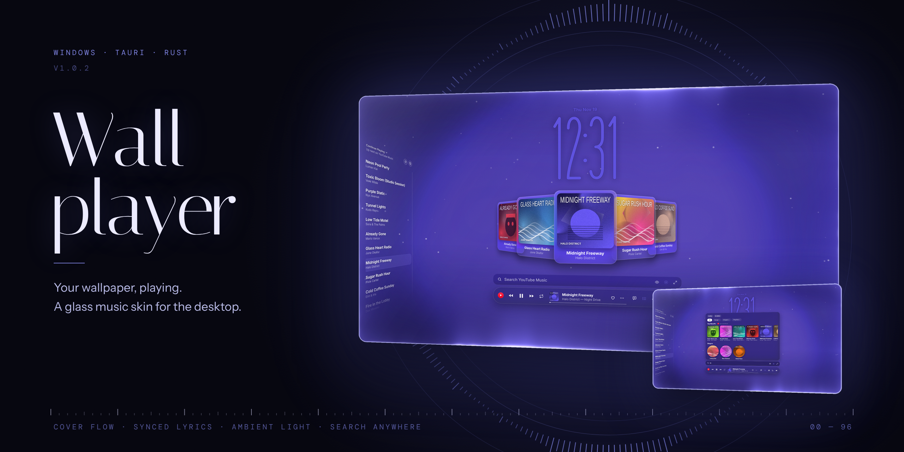

<p align="center">
  
</p>

<h3 align="center">Your wallpaper, playing.</h3>

<p align="center">
  A glass music skin for the Windows desktop — the wallpaper itself becomes the player.<br>
  <sub>Biến hình nền Windows thành trình phát nhạc: đồng hồ cao, cover flow kính, lyrics đồng bộ, viền sáng nhảy theo nhạc.</sub>
</p>

<p align="center">
  
  
  
</p>

---

## What it feels like

Wallplayer lives *behind* your desktop icons, the same way Wallpaper Engine does, so **Win + D keeps it on screen**. A tall hollow clock, a glass cover flow of what is playing, a “Continue Playing” queue and a neon edge light that follows the loudness of whatever your PC is playing.

| | |
|---|---|
| **Smart search** | Songs, **Singers** and **Playlists** in one box — tabs *All · Songs · Singers · Playlists*, typing suggestions, YouTube Music, SoundCloud and Spotify. |
| **Continue Playing** | Pick one song and the queue becomes YouTube’s suggestions for it, mixed with picks from your own account. A **History** button flips it to *History Playing* (last 100 songs). |
| **Synced lyrics** | Found automatically online (LRCLIB, NetEase, Genius), timed to the song, with a second-language subtitle line and per-song offset (`[` `]`). |
| **Ambient light** | WebGL neon edge that reacts to the system audio — Comet, Pulse, Spectrum, Rainbow, Aurora — coloured from the album art. |
| **Backgrounds** | Music video, your own video, “Surprise me” (no AI-generated clips), or your Windows wallpaper between songs. |
| **Lock-screen style editor** | Fonts, glass and colours for the clock and lyrics, like the iPhone lock screen. |
| **Search from anywhere** | The one global shortcut — default `Ctrl + Alt + Space`, rebind it to any key combo **or mouse button**. |
| **Desktop, tidied** | Auto-hides desktop icons (Recycle Bin included) and gives them back when you quit. Multi-monitor and portrait screens supported. |

## Quick start

1. Download `Wallplayer-Windows-x64.zip` from [Releases](../../releases), unzip.
2. Run `Wallplayer.exe` (needs the Microsoft Edge **WebView2 Runtime**; keep `WebView2Loader.dll` next to the exe).
3. Press **Ctrl + Alt + Space** and search. Everything else is in the tray icon and the Appearance panel — see [`HUONG-DAN.txt`](HUONG-DAN.txt) for the full guide (Vietnamese).

> Press **Ctrl + Shift + D** to run the built-in self-test if something Windows-specific misbehaves.

## Architecture

| Layer | Where | What |
|---|---|---|
| Window placement | `src-tauri/src/desktop.rs` | Borderless full-screen window pinned to the bottom of the z-order (subclassed `WM_WINDOWPOSCHANGING`), or re-parented into the shell `WorkerW` behind the icons (classic + Win11 24H2 layouts). Peek mode = top-most for the hotkey search. |
| Now Playing | `src-tauri/src/media.rs` | `GlobalSystemMediaTransportControlsSessionManager` (WinRT): title/artist/album/thumbnail/timeline of Spotify, Apple Music, browsers…; play/pause/next/prev/seek/shuffle. Emits `media`, `media-art`. |
| Ambient spectrum | `src-tauri/src/audio.rs` | WASAPI loopback via `cpal` + 4096-pt FFT (`rustfft`) → `audio-spectrum` [rms, 32 log bands] ≈60 Hz. UI does kick/snare onset detection and drives a WebGL neon-edge shader coloured by the album accent. |
| Accounts | `src-tauri/src/accounts.rs` | YouTube / SoundCloud sign-in windows sharing the WebView2 profile (embedded players run signed-in → Premium/Go+); Spotify OAuth PKCE (user's Client ID) for search + Spotify Connect playback. |
| Network | `src-tauri/src/net.rs` | Per-platform search: YouTube Music (InnerTube WEB_REMIX), YouTube (InnerTube WEB), SoundCloud (api-v2), Apple (iTunes Search); MV ids, LRCLIB synced lyrics, image → data URL. |
| Shell | `src-tauri/src/main.rs` | Tray menu, one rebindable global shortcut (key or mouse button, default Ctrl+Alt+Space), settings, autostart (HKCU Run). |
| UI | `ui/index.html` | Single-file UI. Runs standalone in a browser in demo mode (generated covers, simulated playback). |

Platform behaviour: YouTube Music/Automatic play in-app through the YouTube IFrame player
(video doubles as wallpaper); Spotify opens `spotify:search:`; Apple Music, Spotify Web
Player, SoundCloud and Amazon Music open their search/track page. Whatever plays is picked
up again through Windows media sessions.

## Build

On Windows (MSVC toolchain, recommended):

```
cd src-tauri
cargo build --release
```

Output: `src-tauri/target/release/wallplayer.exe` (WebView2 loader is linked statically on MSVC).

Cross-compiling from Linux (what produced the shipped build):

```
# needs: mingw-w64, rust-std for x86_64-pc-windows-gnu
cargo build --release --target x86_64-pc-windows-gnu
# ship wallplayer.exe together with target/x86_64-pc-windows-gnu/release/WebView2Loader.dll
```

Preview the UI without building: open `ui/index.html` in Chrome/Edge.

## Notes

- Genius, YouTube InnerTube and Google Translate use unofficial endpoints and may change at any time.
- Google lyrics cannot be automated (captcha); the app only opens the browser.
- Design thumbnail: [`docs/thumbnail.png`](docs/thumbnail.png).
